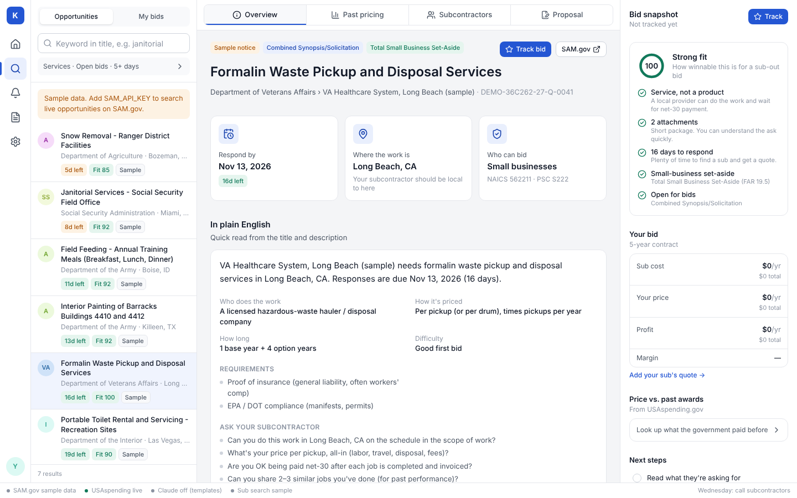

# Kontract

Find government contracts you can win, see what the government paid for the same work before, line up a local subcontractor, put your price on top, and send the proposal. A second section, **Permit leads**, turns each day's building permits into leads you can sell to local contractors, and a **CRM** tracks every contractor you pitch until they pay.



It's built around the playbook for winning your first contract with no experience:

1. **Pick work you understand.** Services, not products. Few attachments. A small-business set-aside. At least a week to respond.
2. **Check past pricing.** Every federal award is public on USAspending.gov. Find the last contract for this work and price against it.
3. **Get a subcontractor's quote before you bid.** Send them a scope of work, then call. Pick the hungry ones who answer fast.
4. **Put your price on top.** The government usually picks the lowest price, so stay under past awards and still keep a margin.
5. **Submit, and keep submitting.** It's a numbers game. Monday find, Tuesday write scopes, Wednesday call subs, Thursday gather quotes, Friday look again.

## Quick start

```bash
npm install
```

```bash
cp .env.example .env.local
```

```bash
npm run dev
```

Needs Node 22.13 or newer (it uses the built-in `node:sqlite`). Open http://localhost:3000 and create an account; each account's bids, profile and CRM are private to it. Everything works without keys: real SAM.gov opportunities (from the daily file), real USAspending pricing, sample subcontractor listings and fill-in templates. The first start takes 10–30 seconds to download SAM.gov's file. Add keys to `.env.local` and restart to switch the rest to live data.

| Key | Unlocks | How to get it |
|---|---|---|
| — | Live opportunities and full descriptions: every active SAM.gov notice, from SAM.gov's free daily file | No key needed. The server downloads the file (~200 MB) at startup, keeps the ~7,000 notices that are still open, and re-checks hourly for a new one. |
| `SAM_API_KEY` (optional) | Attachment links for a notice (the daily file doesn't include them) | Free. Sign in at sam.gov → Profile → Public API Key. Keys without a role allow about 10 requests a day; each notice you list costs one. |
| `ANTHROPIC_API_KEY` | Claude's plain-English read of each notice, scopes of work, outreach emails/call scripts and proposals | platform.claude.com. Uses `claude-opus-5-5` by default (`ANTHROPIC_MODEL` to change). |
| `GOOGLE_PLACES_API_KEY` *or* `APIFY_API_TOKEN` | Real local businesses (rating, reviews, phone, website) when you search for subcontractors | Google Places API (New), or Apify's `compass/crawler-google-places` actor (the same one the Agentic Workflows Google Maps pipeline uses). |
| — | Past award pricing and past winners from USAspending.gov | No key needed. |
| — | Building permits from 19 city and county open-data feeds in 12 states | No key needed. `SOCRATA_APP_TOKEN` (optional, free at any Socrata portal → Developer settings) raises the rate limits. |
| `BETTER_AUTH_SECRET` | Signs session cookies | Optional locally (one is generated into the data folder). Set it in production: `openssl rand -base64 32`. Set `BETTER_AUTH_URL` to the public URL too. |

## What's on screen

The layout follows the wireframe:

| Area | What it does |
|---|---|
| **Left rail** | This week (weekly rhythm + pipeline), Find opportunities, Deadlines, My bids, Permit leads, CRM, Settings, and your account. |
| **Sidebar** | Search every open SAM.gov notice (keyword across titles and descriptions, state, NAICS, set-aside, posted date, time to respond, services only, open bids only), sorted by fit, deadline or newest, 100 at a time. Or switch to My bids filtered by stage. Each item shows days left and a fit score. |
| **Tabs** | **Overview**: what they're asking for in plain English, where, who can bid, requirements, red flags, questions for subs, the notice and attachments, and the contracting officer. **Past pricing**: similar past awards, the typical price per year, and the bid builder (sub cost → your price, per unit, per year, over the contract). **Subcontractors**: scope of work to send, local business search, companies that already won this work, and a shortlist with quotes, a six-point "hunger check" and an email/call script per company. **Proposal**: a pre-submit checklist, the proposal draft (edit, copy, download, print to PDF), and submitted/won/lost. |
| **Right sidebar** | Fit score with the reasons, your bid (sub cost, price, profit, margin), your price against past awards, and next steps. |
| **Bottom bar** | Which data sources are live, today's focus, and bids due this week. |

Anything you price, shortlist or draft is saved to **My bids** automatically. Press **Track** to save one without changing it.

### Permit leads

Every building permit is someone about to spend money on a property, and the trades that come after (fence, landscaping, pools, gutters, blinds…) want to hear about it first. The playbook: pick a city and a trade, offer local companies tomorrow's list free, then charge monthly (e.g. $99) with a no-questions refund if they don't land a job.

| Area | What it does |
|---|---|
| **Sidebar** | Pick a state and a city or county (or all of them), how far back (today to 30 days), and a trade. Each trade shows how many permits mean work for it. More filters: keyword, ZIP, minimum job value, residential only, and leads only (hides electrical, plumbing and sign permits). |
| **Permit** | Address, type, job value, contractor and owner, a link to the city's record, and **who this is a lead for**: each trade with the reason (a new pool needs a safety fence; a new roof is the time for gutters). |
| **Find buyers** | Businesses already pulling that trade's permits in the city (from the permit records), plus a Google Maps search for that trade nearby. **Add to CRM** or **Pitch** any of them. |
| **Pitch** | An editable message that leads with this permit, offers tomorrow's list free, then your price and refund window. Copy it, and **Log as sent** to record it in the CRM with a follow-up in 2 days. |
| **Right panel** | Leads by trade, what N clients at your price adds up to, your CRM in that state, and each feed's status. |

### CRM

Every contractor you add, from permits or by hand. Move them through Prospect → Contacted → Trial → Paying (or Lost), log calls, emails, texts and meetings, set the next follow-up, and keep their contact details and notes. Logging a touch moves a prospect to Contacted. The right panel shows monthly revenue from paying clients, the pipeline by stage, win rate, and who to follow up with today. Contacts are private to your account.

## How it's built

Next.js (App Router) + TypeScript + Tailwind. One app serves the UI and a small JSON API.

```
directives/          SOPs for each step (the "what to do" layer, like the Agentic Workflows setup)
src/lib/             Deterministic tools: SAM.gov daily file + search, USAspending, places search,
                     Claude, bid math, fit score, rule-based breakdowns, templates, permit feeds +
                     trade tagging + pitch, CRM helpers, accounts (Better Auth) and the SQLite store
src/app/api/         HTTP endpoints over src/lib (see below)
src/components/      The UI
.data/               Accounts, pipelines and caches (git-ignored)
```

| Endpoint | Purpose |
|---|---|
| `GET /api/opportunities?q=&state=&naics=&setAside=&postedWithinDays=&minDaysToRespond=&servicesOnly=1&biddableOnly=1&sort=fit\|deadline\|newest&limit=&offset=` | Search opportunities |
| `POST /api/opportunities/description` `{id}` | A notice's full description |
| `POST /api/opportunities/attachments` `{id, postedDate}` | A notice's attachment links (needs `SAM_API_KEY`) |
| `POST /api/opportunities/refresh` | Check SAM.gov for a newer daily file now |
| `POST /api/pricing` `{query:{keywords,naics?,state?,yearsBack?,servicesOnly?},context?}` | Past awards + stats |
| `POST /api/subcontractors` `{query,location}` | Local businesses |
| `POST /api/ai/breakdown` `{opportunity}` | Plain-English breakdown (Claude, or rules) |
| `POST /api/ai/draft` `{kind:"sow"\|"outreach"\|"proposal",deal,subId?}` | Streams a draft as NDJSON |
| `GET/PUT /api/deals`, `DELETE /api/deals/:id` | Your pipeline |
| `GET/PUT /api/profile` | Company profile (UEI, CAGE, contact) used in drafts |
| `GET /api/status` | Which integrations are configured |
| `GET /api/permits?state=TX&source=&days=7&trade=&minValue=&residentialOnly=1&leadsOnly=1&zip=&q=` | Recent permits, counts by trade, busiest contractors, and per-trade contractors |
| `GET /api/permits/sources` | States, city/county feeds and trades |
| `GET/PUT /api/crm`, `DELETE /api/crm/:id` | Your CRM contacts |
| `/api/auth/*` | Sign up, sign in, sign out (Better Auth: `POST /api/auth/sign-up/email`, `/sign-in/email`, `/sign-out`) |

Every endpoint except `/api/auth/*` needs a signed-in session cookie and only sees that account's data. From a terminal:

```bash
curl -s -c .tmp/jar -H 'Origin: http://localhost:3000' -H 'Content-Type: application/json' \
  -d '{"email":"you@example.com","password":"your-password"}' http://localhost:3000/api/auth/sign-in/email
```

```bash
curl -s -b .tmp/jar 'http://localhost:3000/api/permits?state=TX&days=7&trade=fence&leadsOnly=1'
```

```bash
npm test
```

```bash
npm run typecheck
```

## Deploying

Accounts, bids, profiles and CRM contacts live in one SQLite file, `.data/kontract.db`; the SAM.gov index is `.data/sam-opportunities.jsonl`. Run it somewhere with a persistent disk: a VPS, or Railway/Render with a volume mounted and `DATA_DIR` pointing at it. `npm run build && npm start` runs the production server (it listens on `PORT`). It holds the notice index in memory (about 300–400 MB), and needs to reach sam.gov, usaspending.gov and the cities' open-data portals.

On Railway: one service from this repo, a volume mounted at `/data`, and these variables: `DATA_DIR=/data`, `BETTER_AUTH_URL` (the public `https://…` URL), `TRUSTED_IP_HEADER=x-real-ip` (so sign-in rate limits are per visitor), plus whichever API keys you use. `BETTER_AUTH_SECRET` is optional there: without it a secret is generated once into the volume. Anyone with the URL can create an account, so share it with the people you want.

A bids file from before accounts existed (`.data/kontract.json`) is imported into the first account created, then renamed.

## Notes and limits

- Past award amounts are dollars obligated so far, so a contract still in progress shows less than its full value. "Typical per year" uses awards that ran about a year or more when there are enough of them.
- Opportunities come from SAM.gov's nightly file, so a notice posted today appears tomorrow. Amendments are merged into one notice (with an amendment count), and awarded or cancelled solicitations are dropped.
- Most notices don't list a place of performance; then the contracting office's location is shown and labeled as such.
- If the daily file can't be downloaded, you get sample opportunities labeled "Sample" with `DEMO-` numbers until it succeeds.
- Permits come from each city's open-data portal and are cached for an hour. Most cities post a day or two after issuing; some (College Station, Cambridge) post weekly, so pick 14 or 30 days there. Trade tags are rules over the permit's type and description: a good first pass, not a guarantee. Not every city lists the contractor or job value.
- To add a city: find its building-permit dataset on a Socrata portal, check the column names (`https://<domain>/resource/<id>.json?$limit=1`), and add an entry to `src/lib/permit-sources.ts` mapping them. `npm test` checks every entry.
- Drafts are starting points. Read every proposal, replace every `[placeholder]`, and follow the solicitation's own instructions.
